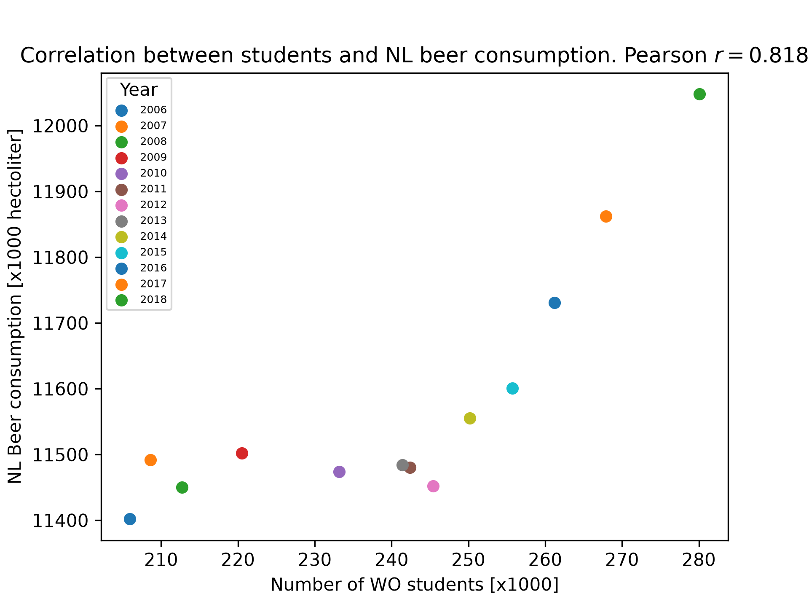

Student ID: 14212781

Van Dyke, M. C. C., Teixeira, M. M., & Barker, B. M. (2019). Fantastic yeasts and where to find them: the hidden diversity of dimorphic fungal pathogens. Current Opinion in Microbiology, 52, 55–63. https://doi.org/10.1016/j.mib.2019.05.002

Harvey, J., Culvenor, J., Payne, W., Cowley, S., Lawrance, M., Stuart, D., & Williams, R. (2002). An analysis of the forces required to drag sheep over various surfaces. Applied Ergonomics, 33(6), 523–531. https://doi.org/10.1016/s0003-6870(02)00071-6

Zeigler, D. W., Wang, C. C., Yoast, R. A., Dickinson, B. D., McCaffree, M. A., Robinowitz, C. B., & Sterling, M. L. (2004). The neurocognitive effects of alcohol on adolescents and college students. Preventive Medicine, 40(1), 23–32. https://doi.org/10.1016/j.ypmed.2004.04.044

The pearson correlation cooficient r = 0.818. This indicates a very strong linear relationship. I can conclude correlation, but not causation ;). 